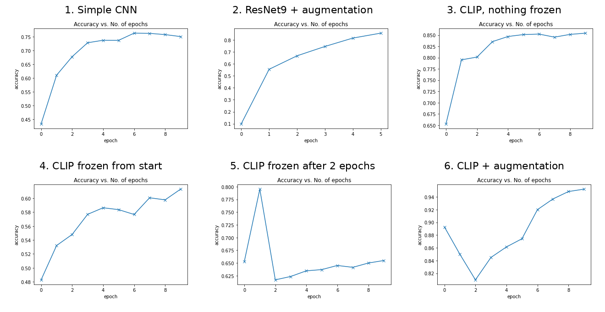
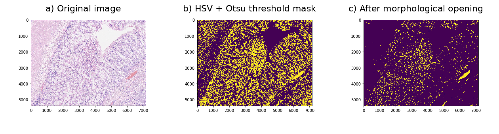
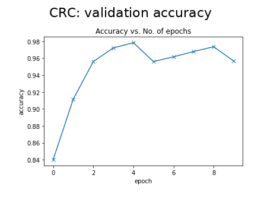

# CLIP Model Fine-Tuning

Experiments that fine-tune the image encoder of OpenAI's [CLIP](https://github.com/openai/CLIP) model for image classification, on two datasets:

- **CIFAR-10** (10 classes of small everyday images): CLIP is compared with two CNNs trained from scratch, and with different ways of freezing CLIP.
- **Colorectal cancer (CRC) histology images** (3 grades): tissue regions are found in large slide images, cut into patches, and CLIP is fine-tuned on the patches.

All experiments are Jupyter notebooks made for **Google Colab**.

## The CLIP model

Every CLIP notebook uses the same model:

1. Each image is resized with CLIP's own preprocessing (224 × 224).
2. The **CLIP ViT-B/32 image encoder** turns it into 512 numbers.
3. A small head classifies it: `Linear(512 → 256) → ReLU → Linear(256 → number of classes)`.

"Fine-tuning" means the CLIP encoder's weights are also trained. "Freezing" means they are kept fixed and only the head is trained.

## CIFAR-10 experiments

Folder: `Cifar10FineTune/`

| # | Notebook | Model | What's special | Test accuracy |
|---|---|---|---|---|
| 1 | `1-NoFineTuneNoAugmentation` | Simple CNN (6 conv + 3 linear layers) | Baseline. No augmentation, no LR schedule. Adam, lr 0.001, 10 epochs. | 75.3% |
| 2 | `2-NoFineTuneWIthAugmentation` | ResNet9 | Augmentation (random crop + flip), normalization, One-Cycle LR schedule, weight decay, gradient clipping. 5 epochs. | 85.7% |
| 3 | `3-NoAugmentationWithFineTune` | CLIP + head | **Nothing frozen**. No augmentation. Adam, lr 0.0001, 10 epochs. | 86.3% |
| 4 | `4-NoAugmentationWithFineTune` | CLIP + head | **CLIP frozen from the start**, only the head is trained. lr 0.0005, 10 epochs. | 61.9% |
| 5 | `5-NoAugmentationWithFineTune` | CLIP + head | **CLIP frozen after 2 epochs**. lr 0.0001, 10 epochs. | 65.9% |
| 6 | `6-FineTuneWithAugmentation` | CLIP + head | **Nothing frozen**, plus augmentation (random crop + flip), One-Cycle LR schedule, weight decay and gradient clipping. 10 epochs. | **95.2%** |

**Main result:** fine-tuning the whole CLIP encoder works much better than freezing it, and adding augmentation and an LR schedule gives the best result (95.2%).

Notebook 3 also checks that the CLIP weights really change during training: it compares the weights before and after one training step.



## CRC experiment

Folder: `CRCFineTune/`, notebook: `NoAugmentationWithFineTune.ipynb`

**Dataset:** [Extended Colorectal Cancer Grading dataset](https://warwick.ac.uk/fac/cross_fac/tia/data/extended_crc_grading/) (University of Warwick): 300 large histology images in 3 classes: Grade 1 (normal), Grade 2 (low grade) and Grade 3 (high grade).

**Steps:**

1. **Find the tissue (ROI).** Large parts of each image are background. To make a tissue mask, the notebook:
   - uses Otsu thresholds on the R, G and B channels to find the bright background,
   - uses an Otsu threshold on the saturation channel (HSV) to find the tissue,
   - cleans the mask with two **morphological openings** (a 9×9 square kernel, then a 7×7 cross kernel).
2. **Cut patches.** It scans the mask and saves 224 × 224 patches from the tissue area into `Patch/Grade1`, `Patch/Grade2` and `Patch/Grade3`. After each saved patch, that area is removed from the mask, so the same spot isn't used again.
3. **Fine-tune CLIP.** Same model as above with 3 outputs, nothing frozen, no augmentation, Adam with lr 0.0001, 10 epochs. The patches are split randomly into 80% training and 20% validation.



**Result:** 95.7% validation accuracy after the last epoch (best: 97.8% at epoch 4).



**Important:** to save time, patch extraction stops as soon as every grade has at least one image's patches. In the saved run, that was **4 of the 300 images** (10,352 patches). Training and validation patches come from these same 4 images, so the validation accuracy does not show how the model works on new images. To use the whole dataset, remove this `break` at the end of the patch extraction cell:

```python
# because we don't have time
if grade1_counter != 0 and grade2_counter != 0 and grade3_counter != 0:
    break
```

## How to run

1. Open a notebook in **Google Colab** (*File → Upload notebook*, or open it from GitHub).
2. Turn on a GPU: *Runtime → Change runtime type → GPU*.
3. Run all cells (*Runtime → Run all*).

That's all. Each notebook installs CLIP (`pip install git+https://github.com/openai/CLIP.git`) and downloads its dataset itself:

- **CIFAR-10:** from `https://s3.amazonaws.com/fast-ai-imageclas/cifar10.tgz` (fast.ai's copy, in folders per class).
- **CRC:** from `https://warwick.ac.uk/fac/cross_fac/tia/data/extended_crc_grading/original_images.zip`. If this link doesn't work, download the original images from the [dataset page](https://warwick.ac.uk/fac/cross_fac/tia/data/extended_crc_grading/) and put the `.png` files in `./Data/Original_Images/`.

**Time (on a Colab GPU):** the CIFAR-10 CLIP notebooks take about 8–11 minutes per epoch, so about 1.5–2 hours for 10 epochs. CRC training takes about 2 minutes per epoch (with the limited patches).

The trained model is saved in the Colab session (for example `cifar10-cnn.pth`). Download it before the session ends if you want to keep it.

## Notes

- In notebooks 1, 3, 4 and 5, 5,000 training images are kept aside for validation, and the test set is used only at the end.
- In notebooks 2 and 6, the **test set is also used for validation** during training. Their test accuracy is the last epoch's result on that set.
- The CRC notebook's name says "NoAugmentation", and it indeed uses no augmentation, LR schedule or weight decay.

## Tech

Python, PyTorch, torchvision, [OpenAI CLIP](https://github.com/openai/CLIP), OpenCV, scikit-image (Otsu threshold, HSV), NumPy, Matplotlib.
